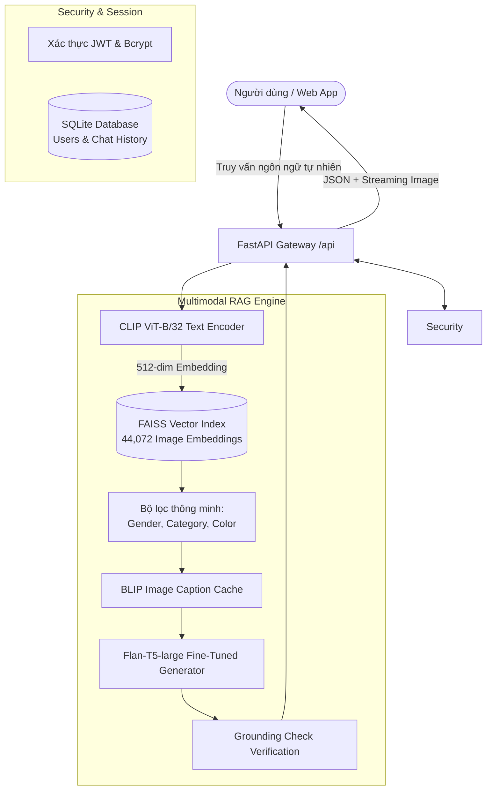

# 🛍️ Fashion RAG v2.0 — Multimodal Fashion AI Assistant

[](https://fastapi.tiangolo.com)
[](https://pytorch.org/)
[](https://huggingface.co/minhunhooo/flan-t5-large-fashion-rag)
[](https://huggingface.co/datasets/ashraq/fashion-product-images-small)

> **Hệ thống Hỏi đáp & Tư vấn Thời trang Đa phương thức (Multimodal RAG)** thế hệ mới: Kết hợp truy xuất ngữ nghĩa thị giác bằng **CLIP ViT-B/32 + FAISS** và sinh câu trả lời có dẫn chứng thực tế bằng **Flan-T5 Large Fine-Tuned**, được tái cấu trúc hoàn toàn trên nền tảng **FastAPI** và giao diện người dùng hiện đại, bảo mật.

---

## 🌟 Những nâng cấp nổi bật trong Phiên bản 2.0 (v2.0)

| Tính năng | Phiên bản cũ (v1 Gradio) | Phiên bản mới (v2 FastAPI + SPA) |
|---|---|---|
| **Kiến trúc Backend** | Đơn khối Gradio server | **FastAPI** chuẩn RESTful API, phân lớp rõ ràng, async non-blocking |
| **Giao diện người dùng (UI)** | Đơn sơ, thiếu đồng bộ | **Giao diện đẳng cấp e-commerce**, Dark/Light mode, hiệu ứng mượt mà |
| **Xác thực người dùng** | Không có tài khoản | **JWT Token + Bcrypt**, Đăng ký/Đăng nhập, 1-Click Quick Demo |
| **Lịch sử hội thoại** | Mất dữ liệu khi refresh | **Lưu trữ phiên SQLite + SQLAlchemy**, tìm kiếm & quản lý hội thoại |
| **Hiển thị sản phẩm** | Ảnh nhỏ đơn điệu | **Thẻ sản phẩm tương tác cao**, xem chi tiết (Modal), điểm tương đồng, caption BLIP |
| **Đánh giá Grounding** | Text nhãn cơ bản | **Huy hiệu trực quan**, phân tích token trùng khớp, đo độ trễ chi tiết |
| **Tối ưu tốc độ ảnh** | Tải chậm qua mạng | **Truy xuất trực tiếp byte ảnh từ Parquet cache** < 5ms |

---

## 🏗️ Kiến trúc Hệ thống (System Architecture)



1. **CLIP ViT-B/32 Embedding**: Chuyển đổi câu hỏi tiếng Anh/tự nhiên thành vector 512 chiều trong cùng không gian với ảnh sản phẩm.
2. **FAISS Vector Search**: Truy xuất Top 30 ứng viên tiềm năng trong không gian cosine similarity từ 44,072 sản phẩm trong chưa đầy 30ms.
3. **Bộ trích xuất & lọc thông minh**: Tự động nhận diện giới tính (Men, Women, Boys, Girls), loại trang phục và màu sắc từ câu hỏi để tinh chỉnh kết quả.
4. **BLIP Caption Cache**: Tích hợp mô tả thị giác chi tiết của từng sản phẩm làm ngữ cảnh phong phú cho mô hình ngôn ngữ.
5. **Flan-T5-large Generator (`minhunhooo/flan-t5-large-fashion-rag`)**: Sinh câu trả lời tự nhiên, chính xác, chỉ đề cập đến các sản phẩm có trong catalog.
6. **Grounding Verification & Latency Tracking**: Đảm bảo 100% câu trả lời bám sát thực tế, đo lường chi tiết thời gian truy xuất và sinh từ.

---

## 📊 Kết quả Thực nghiệm & Benchmark

Dựa trên báo cáo nghiên cứu và bài báo khoa học của tác giả:

| Chỉ số đánh giá | Điểm số đạt được | Ý nghĩa |
|---|---|---|
| **ROUGE-1** | **0.4950** | Mức độ trùng khớp từ đơn so với nhãn chuẩn |
| **ROUGE-L** | **0.4372** | Độ dài chuỗi con chung dài nhất |
| **BERTScore-F1** | **0.9186** | Tương đồng ngữ nghĩa sâu (Contextual Similarity) |
| **Grounding-rate** | **1.0000** | 100% câu trả lời có căn cứ từ catalog truy xuất |
| **Composite Score** | **0.7907** | Điểm tổng hợp chất lượng hệ thống |

---

## 🚀 Hướng dẫn Cài đặt & Khởi chạy

### 1. Cài đặt thư viện phụ thuộc
```bash
pip install -r requirements.txt
```

### 2. Khởi chạy ứng dụng
Chạy lệnh duy nhất để khởi động toàn bộ hệ thống:
```bash
python run.py
```

Sau khi chạy thành công:
- **Giao diện Web Người dùng**: [http://localhost:8000](http://localhost:8000)
- **Tài liệu Swagger API**: [http://localhost:8000/docs](http://localhost:8000/docs)
- **Tài liệu ReDoc API**: [http://localhost:8000/redoc](http://localhost:8000/redoc)

---

## 🔑 Tài khoản Thử nghiệm (Có sẵn trong hệ thống)

Hệ thống được khởi tạo sẵn các tài khoản demo hoặc bạn có thể tự tạo tài khoản mới:

- **Tài khoản Demo (1-Click Login trên giao diện)**:
  - Username: `demo`
  - Password: `demo123`
- **Tài khoản Quản trị**:
  - Username: `admin`
  - Password: `admin123`

---

## 📁 Cấu trúc Thư mục Dự án

```
fashion-rag/
├── backend/
│   ├── app/
│   │   ├── main.py              # Điểm khởi động FastAPI và cấu hình CORS
│   │   ├── core/
│   │   │   ├── config.py        # Cấu hình hệ thống, đường dẫn, tham số mô hình
│   │   │   ├── security.py      # Mã hóa Bcrypt và cấp phát mã JWT
│   │   │   └── database.py      # Kết nối cơ sở dữ liệu SQLite & SQLAlchemy
│   │   ├── models/              # Định nghĩa bảng Users, Conversations, Messages
│   │   ├── schemas/             # Pydantic schemas cho API Request/Response
│   │   ├── services/
│   │   │   ├── rag_engine.py    # Pipeline Multimodal RAG (CLIP, FAISS, T5, Grounding)
│   │   │   ├── catalog_service.py # Quản lý metadata 44k sản phẩm và ảnh Parquet
│   │   │   └── auth_service.py  # Dịch vụ xác thực và phân quyền
│   │   └── api/                 # Các REST API endpoints
│   └── static/                  # Giao diện người dùng hiện đại
│       ├── css/style.css        # Hiệu ứng Glassmorphism & Animation
│       ├── js/app.js            # Controller quản trị giao diện (Alpine.js)
│       └── index.html           # Single Page Application
├── docs/                        # Báo cáo và bài báo khoa học đính kèm
│   ├── BaiBao_FashionRAG_HoMinhHung.docx
│   └── BaoCao_FashionRAG_HoMinhHung.docx
├── data_cache/                  # Cache chỉ mục FAISS, metadata và caption
├── run.py                       # Script khởi chạy nhanh 1 chạm
├── requirements.txt             # Danh sách thư viện đầy đủ
└── README.md
```

---

## 👨‍💻 Tác giả
- **Hồ Minh Hưng**
- Dự án phục vụ báo cáo khoa học, đồ án chuyên ngành và Portfolio CV trí tuệ nhân tạo.
